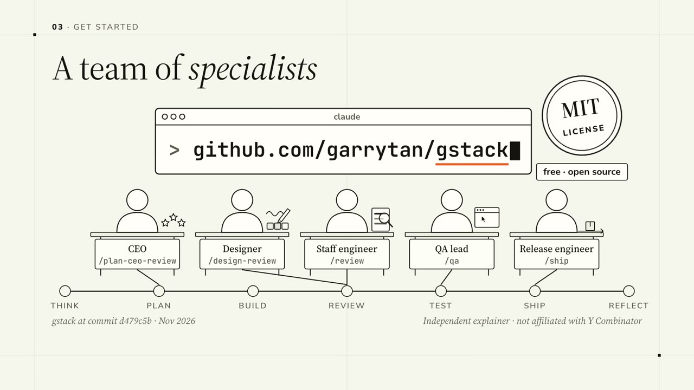

# gstack, explained

A 5-minute narrated walkthrough of [gstack](https://github.com/garrytan/gstack) for developers: what it is, one sprint from start to finish, and how to get started.

Learning a new tool costs the most in communication: someone has to explain what it is and how the pieces fit. This video gives anyone who wants to use gstack the high-level picture in five minutes, before they read the docs.

**Watch:** [gstack-explained-1080p60.mp4](https://github.com/flowos-official/gstack-explained/releases/download/v1.0/gstack-explained-1080p60.mp4) (5:08, 1080p, 40 MB) · [English subtitles (.srt)](https://github.com/flowos-official/gstack-explained/releases/download/v1.0/gstack-explained.en.srt)

## Chapters

| Time | Chapter |
|---|---|
| 0:00 | What gstack is: one long pass vs. explicit gears |
| 0:30 | A team in a terminal; a skill is a file |
| 1:03 | A process, not a toolbox |
| 1:20 | Think: `/office-hours` and the pushback |
| 1:50 | Plan: `/plan-ceo-review` and `/autoplan` |
| 2:19 | Build: `/verify` |
| 2:30 | Review: `/review`, and a second opinion with `/codex` |
| 2:54 | Test: `/qa` and the browser under the hood |
| 3:20 | Ship and reflect: `/ship`, `/retro` |
| 3:45 | Guardrails (`/careful`, `/freeze`, `/guard`) and parallel sprints |
| 4:10 | Get started: install, team mode, a first session |

## Accuracy

Commands, roles and facts were checked against gstack `main` at commit `d479c5b` (8 Nov 2026). The example app is the one in the gstack README. If something is wrong or out of date, please [open an issue](https://github.com/flowos-official/gstack-explained/issues).

## License

The video and subtitles are licensed [CC BY 4.0](https://creativecommons.org/licenses/by/4.0/): link, embed or re-cut them with credit. gstack itself is MIT-licensed by its authors.

---

Independent explainer, not affiliated with Y Combinator or the gstack maintainers. Made by [FlowOS](https://flowos.work).
